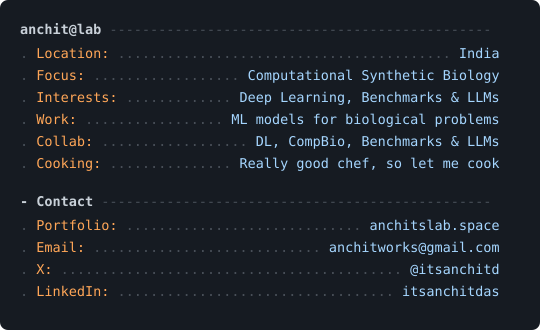

<div align="center">
  <table>
    <tr>
      <td align="center" valign="middle">
        <a href="https://www.anchitslab.space">
          
        </a>
      </td>
      <td align="center" valign="middle">
        
      </td>
    </tr>
  </table>

  <a href="https://github.com/ianchitdas">
    
  </a>

  <p>
    <a href="https://www.anchitslab.space"></a>
    <a href="mailto:anchitworks@gmail.com"></a>
    <a href="https://x.com/itsanchitd"></a>
    <a href="https://www.linkedin.com/in/itsanchitdas"></a>
  </p>
</div>

---

### `About`

I work where **machine learning meets biology**, building models that help make sense of how cells behave and how proteins fold, bind and function. I like projects that are rigorous, reproducible and a little bit weird.

- 🧬 Predicting cellular responses to perturbations with deep learning
- 🧪 Interested in computational synthetic biology and protein modeling
- 📏 Care a lot about honest benchmarks and evaluation
- 🍛 Occasionally write fewer papers and cook some biriyani

---

### `Featured Projects`

| Project | Description | Stack |
| :--- | :--- | :--- |
| [**Virtual Cell**](https://github.com/ianchitdas/Virtual-Cell) | Predicting genetic perturbations using deep learning | `Python` `PyTorch` |

<details>
<summary><code>+ More projects</code></summary>

<br />

- [**My Website**](https://github.com/ianchitdas/anchit) — Personal portfolio placeholder

</details>

> See everything else on [anchitslab.space](https://www.anchitslab.space) or in my [repositories](https://github.com/ianchitdas?tab=repositories).

---

### `Tech Stack`

<p>
  <a href="https://www.python.org/"></a>
  <a href="https://www.rust-lang.org/"></a>
  <a href="https://docs.microsoft.com/en-us/cpp/?view=msvc-170"></a>
  <a href="https://docs.microsoft.com/en-us/dotnet/csharp/"></a>
  <a href="https://www.typescriptlang.org/"></a>
  <a href="https://developer.mozilla.org/en-US/docs/Web/JavaScript"></a>
  <a href="https://www.r-project.org/"></a>
  <a href="https://www.gnu.org/software/bash/"></a>
  <a href="https://pytorch.org/"></a>
  <a href="https://www.tensorflow.org/"></a>
  <a href="https://huggingface.co/"></a>
  <a href="https://nextjs.org/docs"></a>
  <a href="https://reactjs.org/"></a>
  <a href="https://angular.io/"></a>
  <a href="https://vitejs.dev/"></a>
  <a href="https://ui.shadcn.com/"><picture><source media="(prefers-color-scheme: dark)" srcset="https://cdn.simpleicons.org/shadcnui/ffffff" /><source media="(prefers-color-scheme: light)" srcset="https://cdn.simpleicons.org/shadcnui/000000" /></picture></a>
  <a href="https://sass-lang.com/"></a>
  <a href="https://flutter.dev/"></a>
  <a href="https://fastapi.tiangolo.com/"></a>
  <a href="https://www.djangoproject.com/"></a>
  <a href="https://flask.palletsprojects.com/en/3.0.x/"></a>
  <a href="https://nodejs.org/en/"></a>
  <a href="https://expressjs.com/"></a>
  <a href="https://www.postgresql.org/"></a>
  <a href="https://www.mongodb.com/"></a>
  <a href="https://www.mysql.com/"></a>
  <a href="https://supabase.io/"></a>
  <a href="https://firebase.google.com/"></a>
  <a href="https://clerk.com/"></a>
  <a href="https://store.arduino.cc/"></a>
  <a href="https://www.raspberrypi.org/"></a>
  <a href="https://www.docker.com/"></a>
  <a href="https://kubernetes.io/"></a>
  <a href="https://cloud.google.com/"></a>
  <a href="https://www.heroku.com/"></a>
  <a href="https://www.linux.org"></a>
  <a href="https://ubuntu.com/"></a>
  <a href="https://git-scm.com/"></a>
  <a href="https://code.visualstudio.com/"></a>
</p>

---

### `GitHub Stats`

<p align="center">
  
  
</p>

<p align="center">
  
</p>

---

### `Currently`

```text
> Working on  :  Virtual Cell & computational synthetic biology
> Learning    :  Protein modeling, benchmarks & LLM evals
> Ask me about:  Bio-ML, Rust for science, or how to cook dal
```

---

### `Let's Connect`

Open to collaborations in **Bio-ML**, scientific computing and evaluation research. The best way to reach me is by [email](mailto:anchitworks@gmail.com), or say hi on [X](https://x.com/itsanchitd) or [LinkedIn](https://www.linkedin.com/in/itsanchitdas).

<div align="center">
  
</div>
