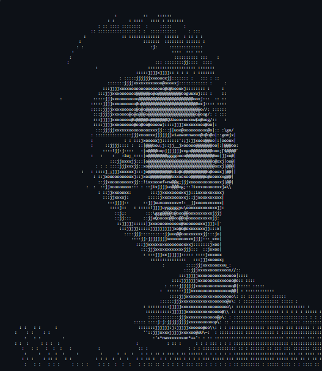

<div align="center">
  <table>
    <tr>
      <td align="center" valign="middle">
        <a href="https://www.anchitslab.space">
          
        </a>
      </td>
      <td align="center" valign="middle">
        
      </td>
    </tr>
  </table>

  <p>
    <a href="https://www.anchitslab.space"></a>
    <a href="mailto:anchitworks@gmail.com"></a>
    <a href="https://x.com/itsanchitd"></a>
    <a href="https://www.linkedin.com/in/itsanchitdas"></a>
  </p>
</div>

---

### `// Featured Projects`

| Project | Description | Stack |
| :--- | :--- | :--- |
| [**Virtual Cell**](https://github.com/ianchitdas/Virtual-Cell) | Predicting cellular perturbations using deep learning | `Python` `PyTorch` |

<details>
<summary><code>+ More projects</code></summary>

<br />

- [**My Website**](https://github.com/ianchitdas/anchit) — Personal portfolio placeholder

</details>

> See everything else on [anchitslab.space](https://www.anchitslab.space) or in my [repositories](https://github.com/ianchitdas?tab=repositories).

---

### `// Currently`

```text
> Working on  :  Virtual Cell & computational synthetic biology
> Learning    :  Protein modeling, benchmarks & LLM evals
> Ask me about:  Bio-ML, Rust for science, or how to cook dal
